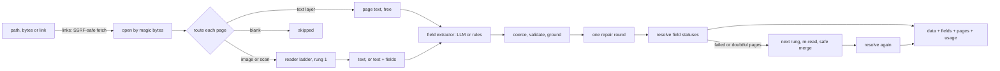
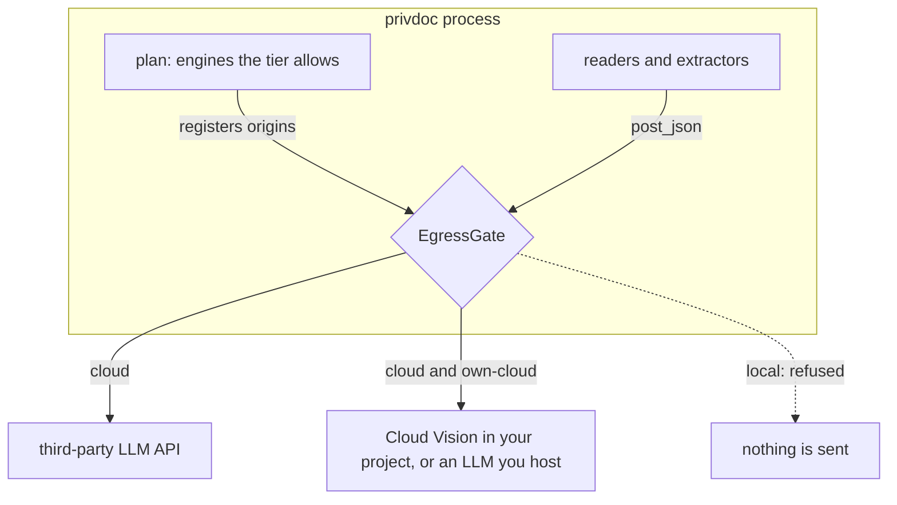

# private-doc-extractor

**Turn PDFs, scans and phone photos into JSON that validates against your schema, and decide
where the document is allowed to go while you do it:** to a cloud vision model, to OCR in your
own cloud account, or nowhere at all.


```text
$ privdoc extract receipt.pdf --schema receipt --tier local        # page 1 typed, page 2 scanned
{
  "valid": false,  "complete": false,  "tier": "local",
  "data": {"merchant_name": "Sunrise Deli", "date": "2026-05-19", "time": "16:42"},
  "errors": [{"path": "/total", "message": "required field is missing (status: not_checked)"}],
  "fields": {
    "date":  {"status": "found", "value": "2026-05-19", "confidence": "medium", "page": 1,
              "evidence": "Date: 2026-05-19 Time: 16:42", "source": "rules", "grounded": true},
    "total": {"status": "not_checked", "value": null, "pages_unread": [2]}, ...
  },
  "pages": [
    {"page": 1, "route": "text-layer", "reason": "text layer with 128 characters", "status": "read"},
    {"page": 2, "route": "ocr", "reason": "an image covers 100% of the page: treated as a scan",
     "status": "no_engine"}
  ],
  "pages_unread": [{"page": 2, "reason": "scanned page, and no OCR engine is available in this tier"}],
  "data_sent_to": [],  "usage": {"llm_calls": 0, "cost_usd": 0.0, ...},  "seconds": 0.048
}
```

That run happened on a machine without Tesseract. The typed page was read for free, the scanned
page could not be read locally, so the total is reported as **not checked**, never as "not on
the document", and nothing left the machine (exit code 1: read, but incomplete).

## What's inside

| | |
|---|---|
| **Text layer first** | Every PDF page is routed on its own. Real text layers are read for free; only pages that are images go to OCR. A "searchable scan" (an invisible OCR layer over a page image) is OCR'd anyway, because copier text layers drop handwriting. |
| **Privacy tiers that are enforced** | `cloud`, `own-cloud` or `local` (the default). The plan only uses engines the tier allows (asking for another one is refused before the file is opened), and every request that could carry document content passes one gate that admits only the exact origins the plan registered. In `local` nothing is sent; the tests prove it with a socket-level tripwire. |
| **Schema-strict JSON** | A JSON Schema subset that is enforced completely: an unsupported keyword is refused, not ignored. Model output is coerced, validated, repaired once, and only valid values ever reach `data`. |
| **Honest field statuses** | `found`, `unreadable` (with what could be made out), `invalid` (with the raw value), `not_found` (every page was read) and `not_checked` (some pages were not). |
| **Grounding** | A value must be traceable to verbatim text on its page. Ungrounded values are downgraded to low confidence and re-checked. |
| **Per-page escalation** | Only failed or doubtful pages are re-read by the next, stronger engine (a larger model, or Tesseract at 400 dpi on a cleaned image). The merge never turns something seen into "not on the document". |
| **Content-addressed cache** | Keys hash the document, the page, the engine's fingerprint, the schema and the prompt version; failed readings are never cached. |
| **SSRF-safe links** | DNS is resolved once and the connection pinned to the checked address; every redirect hop is re-checked; IPv4 hidden in IPv6 and numeric host tricks are refused; size, time and content type are capped. |
| **Benchmark** | Synthetic invoices, receipts and tax forms generated in code in five renderings (typed, scanned, searchable scan, mixed, phone photo), plus an optional FUNSD download. Reports field accuracy, hallucination rate, cost and seconds per page. |
| **Tested offline** | 542 tests run with no network and no keys: the LLM, Cloud Vision and the Tesseract binary are faked, HTTP-level tests use a server on 127.0.0.1, and a suite-wide guard fails any test that reaches the internet. |

## Architecture



Every network request that can carry document content goes through one choke point:



| Tier | Scanned pages are read by | Fields are extracted by | Escalation rung | What leaves the machine |
|---|---|---|---|---|
| `cloud` | a vision LLM (else Cloud Vision, else Tesseract) | a text LLM (else rules) | the larger model | page images and text, to the configured LLM API |
| `own-cloud` | Google Cloud Vision in your own project (else Tesseract) | rules, or an LLM you host (`PRIVDOC_LLM_OWNED=true`) | your own LLM, if configured | page images, to services under your own account |
| `local` | Tesseract | rules | Tesseract at 400 dpi on a cleaned image | nothing |

Main modules: [`pipeline.py`](src/privdoc/pipeline.py) (orchestration),
[`routing.py`](src/privdoc/routing.py), [`plan.py`](src/privdoc/plan.py) (tiers to engines),
[`privacy.py`](src/privdoc/privacy.py) (the gate), [`fields.py`](src/privdoc/fields.py)
(statuses and the escalation merge), [`schema.py`](src/privdoc/schema.py),
[`fetch.py`](src/privdoc/fetch.py), [`engines/`](src/privdoc/engines) and
[`bench.py`](src/privdoc/bench.py).

### The parts that are harder than they look

**1. Text layers lie.** A copier's "searchable PDF" puts an invisible OCR layer over the page
image. It usually holds the printed labels and misses what was handwritten or stamped, so
trusting it silently loses exactly the values you wanted. A page where one image covers at least
60% is treated as a scan whatever its text layer says; a typed page with a small logo stays on
the free path; a page with only vector drawing (outlined text) is OCR'd rather than called blank;
a truly blank page is skipped without making the document "incomplete"
([`routing.py`](src/privdoc/routing.py)).

**2. "Not found" is a claim about the whole document.** If page 2 failed (an API error, a
timeout, no OCR engine, outside `--pages`, over the page cap), a field missing from page 1 is
`not_checked`, listed with the unread pages, and `complete` is false. `not_found` is only
reported when every page was actually read.

**3. A stronger model can be wrong in a new way.** Escalation re-reads one page, and the two
readings are merged per field ([`fields.py`](src/privdoc/fields.py)):

| First reading | Stronger reading | Result |
|---|---|---|
| anything | valid value | the stronger value |
| valid value | invalid value | the first value |
| anything | unreadable | unreadable, first value kept as `partial` |
| confident, grounded value | nothing | the first value (a stronger model can miss one too) |
| low-confidence or unreadable | nothing | unreadable with `partial`: ask a human |

A parametrized test checks all 48 combinations: anything seen on the first pass is never turned
into "not on the document".

**4. Valid is not the same as true.** A well-formed, schema-valid value can still be invented.
A value is grounded when the evidence quoted for it occurs verbatim in the page text and the
value is consistent with that evidence (without evidence, the value itself must be on the page):
"$1,250.00" grounds 1250.0, "03/14/2026" grounds 2026-03-14
([`grounding.py`](src/privdoc/grounding.py)). Ungrounded values drop to low confidence, which
triggers escalation; the benchmark's hallucination rate measures what is left.

**5. Privacy is enforced where bytes leave, not where engines are chosen.** The gate compares
the full origin (scheme, host and port) of every request against what the plan registered,
records the destination *before* sending (a failure can come after the upload), and refuses to
send to a third party over plain http. The local tier makes no socket or DNS call at all,
asserted by a tripwire on `socket.connect`, `create_connection` and `getaddrinfo` around both the
pipeline and the CLI. Smaller leaks are closed too: `OPENAI_API_KEY` is only ever sent to
api.openai.com, never to a custom base URL; photos are turned upright and re-encoded without
EXIF/GPS metadata before any engine sees them; document text is fenced so it cannot fake page
markers or close the document block in a prompt.

**6. Checking the URL string is not SSRF protection.** The fetcher
([`fetch.py`](src/privdoc/fetch.py)) resolves the host once, refuses it if *any* answer is not
globally routable (also looking inside IPv4-mapped, compatible, 6to4, Teredo and NAT64 IPv6
addresses), then connects to exactly that address while keeping the host name for SNI,
certificate checks and the Host header, so a DNS answer cannot change between check and use.
Redirects are followed by hand and every hop is checked again. Numeric shorthands such as
`2130706433` and `0x7f.1` are refused instead of being left to a parser to interpret.
Credentials in URLs, backslashes and control characters are refused; proxies are not used;
compressed bodies are refused rather than inflated; the size cap holds even without a
Content-Length; a trickling server hits an overall deadline; and the body must really be a
supported document whose declared type agrees with its magic bytes.

**7. Strict means refusing what you cannot enforce.** Silently ignoring `oneOf` or a `format`
you do not check is worse than no validation. The schema module accepts a subset it enforces
completely, closes every object, and generates the strict form that structured-output APIs need
(every property required, optional values nullable, validation keywords moved into
descriptions), then enforces those keywords itself on the way back. Repair is a ladder:
deterministic coercion first ("$1,250.00", "Yes", "March 14, 2026"), then one model repair round
listing the exact JSON paths that failed, then the value is reported as `invalid` and kept out of
`data`.

**8. A cache key must cover everything that changes the answer.** Readings are keyed by the
document's SHA-256, the page, the engine's fingerprint (model, provider host, resolution, OCR
language, Tesseract settings), the schema fingerprint and `PROMPT_VERSION`. Changing any of them
simply misses the cache. Failed readings are never cached, so a transient 500 is retried next
time.

## Quick start

Requirements: Python 3.11+. Optional: [Tesseract](https://github.com/tesseract-ocr/tesseract)
for scanned pages in the local tier (`apt install tesseract-ocr`, `brew install tesseract`, or
the Windows installer).

```bash
python -m venv .venv && source .venv/bin/activate      # Windows: .venv\Scripts\activate
pip install -e ".[dev]"

privdoc synth samples --kind invoice --variant text --variant scan --count 1
privdoc extract samples/invoice-0-text.pdf --schema invoice      # local tier: nothing leaves
privdoc check                                                     # engines per tier; sends nothing
python examples/quickstart.py                                     # the same, from Python
```

Cloud tier (any OpenAI-compatible API with JSON-schema output):

```bash
cp .env.example .env              # set PRIVDOC_LLM_API_KEY, the models and PRIVDOC_PRICES
privdoc extract scan.pdf --schema invoice --tier cloud --env-file .env
```

From Python:

```python
import privdoc

result = privdoc.extract("invoice.pdf", schema="invoice")   # tier from PRIVDOC_TIER, default local
if result.valid:
    save(result.data)                                         # validates against the schema
for name, field in result.fields.items():
    if field.status in ("unreadable", "invalid", "not_checked"):
        ask_a_human(name, field)
```

`Pipeline(Settings.from_env(...)).extract(source, schema, ExtractOptions(tier=..., pages=...))`
gives full control. A custom schema example is in
[`examples/custom_schema.py`](examples/custom_schema.py).

### CLI

| Command | |
|---|---|
| `privdoc extract FILE_OR_LINK --schema S` | `--tier`, `--engine auto\|vision-llm\|cloud-ocr\|tesseract`, `--extractor auto\|llm\|rules`, `--pages 1-3,5`, `--force-ocr`, `--no-escalate`, `--no-cache`, `--include-text`, `--out FILE`, `--compact`, `--env-file` |
| `privdoc check` | the engines, destinations and notes for every tier; sends nothing |
| `privdoc synth DIR` | synthetic documents with ground-truth JSON next to each |
| `privdoc bench` | the benchmark (below) |
| `privdoc cache purge\|path` | |

Exit codes: `0` extracted and schema-valid, `1` extracted but incomplete or invalid, `2` usage
error or refused by the privacy tier or SSRF guard, `3` the document could not be read. Errors
are one line, with no stack trace, no API key and no full URL.

### Schemas

Built in: [`invoice`](src/privdoc/schemas/invoice.schema.json) (with line items),
[`receipt`](src/privdoc/schemas/receipt.schema.json) and
[`tax_form`](src/privdoc/schemas/tax_form.schema.json). Your own: any JSON file using `type`
(one type, optionally with `null`), `properties`, `required`, `items`, `enum`, `const`,
`pattern`, `format` (`date`, `date-time`, `email`), `minimum`/`maximum` (and exclusive),
`minLength`/`maxLength`, `minItems`/`maxItems`, plus annotations. `x-labels` lists the printed
labels a value may appear under, used by the rule extractor and in prompts. Anything else is
refused with its location.

## Configuration

Environment variables, optionally from `--env-file` (real environment variables win). See
[`.env.example`](.env.example).

| Variable | Default | |
|---|---|---|
| `PRIVDOC_TIER` | `local` | `cloud`, `own-cloud` or `local` |
| `PRIVDOC_LLM_BASE_URL` | `https://api.openai.com/v1` | any OpenAI-compatible chat-completions API |
| `PRIVDOC_LLM_API_KEY` | — | falls back to `OPENAI_API_KEY` only for api.openai.com |
| `PRIVDOC_LLM_MODEL` / `PRIVDOC_LLM_ESCALATION_MODEL` | — | first-pass model / model for hard pages |
| `PRIVDOC_LLM_OWNED` | `false` | the LLM runs in your own account or servers: usable in `own-cloud` |
| `PRIVDOC_GCV_API_KEY` or `PRIVDOC_GCV_ACCESS_TOKEN` | — | Cloud Vision in your project (`PRIVDOC_GCV_QUOTA_PROJECT`, `PRIVDOC_GCV_ENDPOINT`) |
| `PRIVDOC_TESSERACT_CMD` / `PRIVDOC_TESSERACT_LANG` | `tesseract` / `eng` | |
| `PRIVDOC_PRICES` | — | `model=IN/OUT` USD per 1M tokens, from your provider's price list |
| `PRIVDOC_OCR_PRICE_PER_PAGE` | — | USD per Cloud Vision page |
| `PRIVDOC_CACHE` / `PRIVDOC_CACHE_DIR` / `PRIVDOC_CACHE_TTL_DAYS` | `on` / per-user cache dir / `30` | `$XDG_CACHE_HOME/privdoc`, else `~/.cache/privdoc` (`%LOCALAPPDATA%\privdoc\cache` on Windows) |
| `PRIVDOC_MAX_PAGES` / `PRIVDOC_MAX_ESCALATIONS` | `20` / `3` | pages read / pages re-read per document |
| `PRIVDOC_MIN_TEXT_CHARS` / `PRIVDOC_SCAN_COVER` | `30` / `0.6` | routing thresholds |
| `PRIVDOC_CONCURRENCY` / `PRIVDOC_TIMEOUT` | `4` / `300` | parallel page reads / seconds per document |
| `PRIVDOC_MAX_FILE_MB` / `PRIVDOC_FETCH_MAX_MB` / `PRIVDOC_FETCH_TIMEOUT` | `50` / `25` / `30` | |
| `PRIVDOC_DATE_ORDER` | `MDY` | how to read 04/03/2026 when both parts could be the month |

No model prices are built in: costs are estimated only for models you price, and reported as
unknown otherwise.

## Benchmark

```bash
privdoc bench --tier local --per-kind 4 --json bench.json          # synthetic, offline
privdoc bench --tier cloud --env-file .env                         # same documents, your LLM
python scripts/download_funsd.py --dest ~/.cache/privdoc/datasets   # optional public data
privdoc bench --dataset funsd --dataset-dir ~/.cache/privdoc/datasets --tier cloud --env-file .env
```

For every field the schema asks for, the ground truth either has a value (present) or the field
is not on the document (absent: optional fields the generator left out, and for FUNSD questions
borrowed from other forms). **Field accuracy** = correct / present (text compared ignoring case
and punctuation, numbers to the cent, dates by day). **Hallucination rate** = returned values
that occur nowhere in the document's real text / all returned values. A wrong pick of a real
value (the subtotal returned as the total) is an error but not a hallucination; a value for an
absent field always is.

Measured with `privdoc bench --tier local --per-kind 4` on a laptop **without Tesseract**
installed, 60 documents, 84 pages (two runs: identical counts, timings vary slightly):

| Slice | Docs | Pages | Field accuracy | Hallucination rate | Invented (absent fields) | Cost / page | Seconds / page |
|---|---|---|---|---|---|---|---|
| typed PDFs (`text`) | 12 | 16 | 100.0% (99/99) | 0.0% (0/99) | 0/17 | $0 | 0.01-0.03 |
| `mixed` (typed page 1, scanned page 2) | 12 | 24 | 50.5% (50/99) | 0.0% (0/50) | 0/17 | $0 | 0.01 |
| `scan`, `searchable-scan`, `photo` | 36 | 44 | 0.0% (0/297) | no values returned | 0/51 | $0 | <0.01 |
| all | 60 | 84 | 30.1% (149/495) | 0.0% (0/149) | 0/85 | $0 | 0.01 |

With no OCR engine, every scanned page was reported unread and every field on it `not_checked`:
not one value was guessed for the 85 fields that were not on their documents. The CI `ocr` job
installs Tesseract, runs the integration tests and the same benchmark (2 documents per kind and
variant), and uploads the full report (`bench-results.json`) as a build artifact. Numbers for a
cloud model depend on the model and its price, so measure them with your own key.

## Testing

```bash
pytest                  # 542 passed, 4 skipped in 20-35 s; no network, no keys
ruff check src tests scripts examples
pytest -m tesseract     # the real Tesseract binary (skipped when it is not installed)
```

- [`tests/fakes.py`](tests/fakes.py) fakes the HTTP layer behind the gate, an OpenAI-compatible
  LLM that answers per request kind, and the Tesseract subprocess (it returns real TSV).
  [`tests/oracle.py`](tests/oracle.py) turns synthetic ground truth into a perfect model, which
  tests perturb on purpose: a low-confidence total, an invented invoice number, a 500 on one page.
- [`tests/conftest.py`](tests/conftest.py) limits every test to loopback sockets and literal-IP
  DNS, so a test that touches the internet fails. `no_network_at_all` also blocks loopback and
  records every attempt, for the local-tier tests.
- The SSRF guard and the HTTP transport are also tested against a real server on 127.0.0.1
  (pinning, redirects into link-local space, a chunked body past the cap).
- The 4 skipped tests need POSIX file permissions or the Tesseract binary; CI on Linux covers
  the first, and the `ocr` job covers the second.

## Security notes

- **The cache stores results in plaintext**, including page text and field values: private
  directory (0700, files 0600), 30-day TTL, `privdoc cache purge`, `--no-cache`,
  `PRIVDOC_CACHE=off`.
- **`cloud` sends page images and text to your LLM provider**; its data-retention terms apply.
  **`own-cloud` means your own account** (for example a Google Cloud project), governed by your
  agreement with that provider: it is not on-premises.
- **Document text is untrusted input.** It is fenced in prompts, the model's answer is
  constrained to the schema, values that cannot be traced to the page text are flagged and
  re-checked, and the model has no tools.
- **Fetching a link tells its server it was opened**, so the local tier refuses links: download
  the file yourself.
- Tesseract reads each page from a private temporary directory that is deleted right after.
- API keys never appear in errors or logs, even when an API echoes them back.

## Roadmap

- Rotation and deskew for sideways photos (Tesseract OSD, or a rotation field in the page schema)
- More own-cloud OCR backends (AWS Textract, Azure AI Document Intelligence)
- `$ref`/`$defs` and `oneOf` in the strict schema subset
- Cross-field checks as a validation stage (line items sum to the subtotal, subtotal + tax = total)
- Local text extraction for Office documents
- A batch mode and a small HTTP service

## License

MIT
